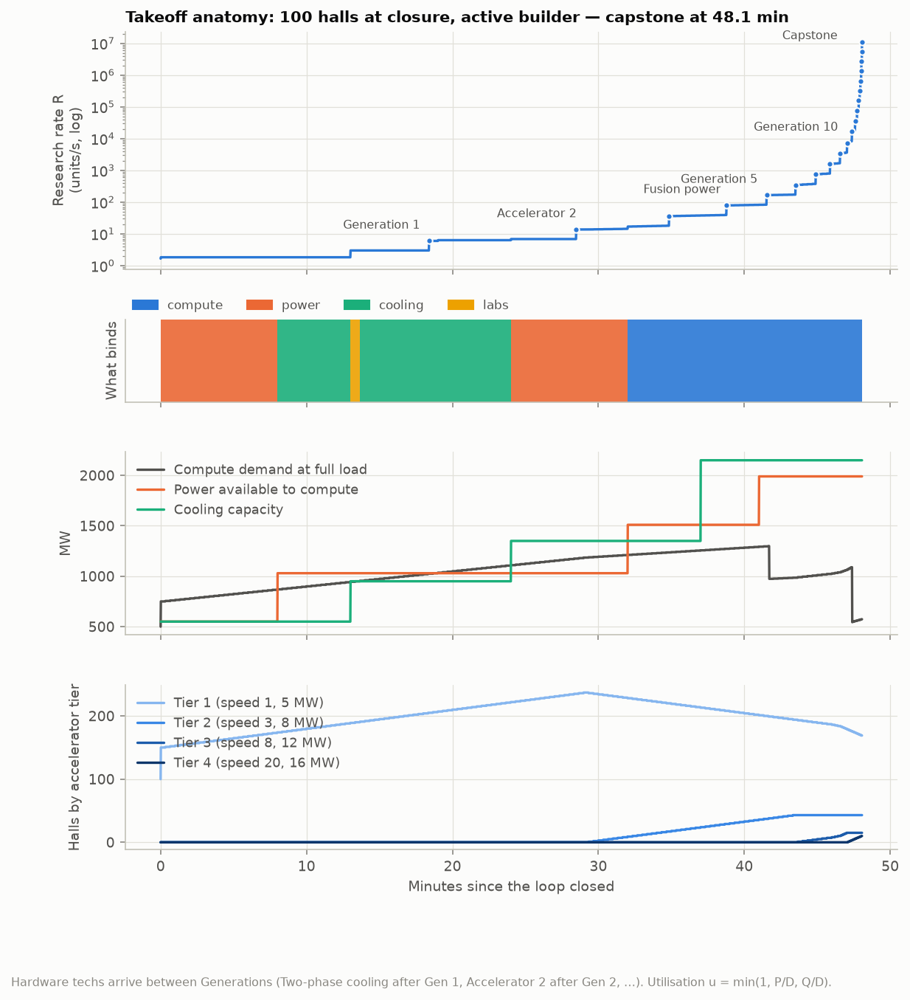
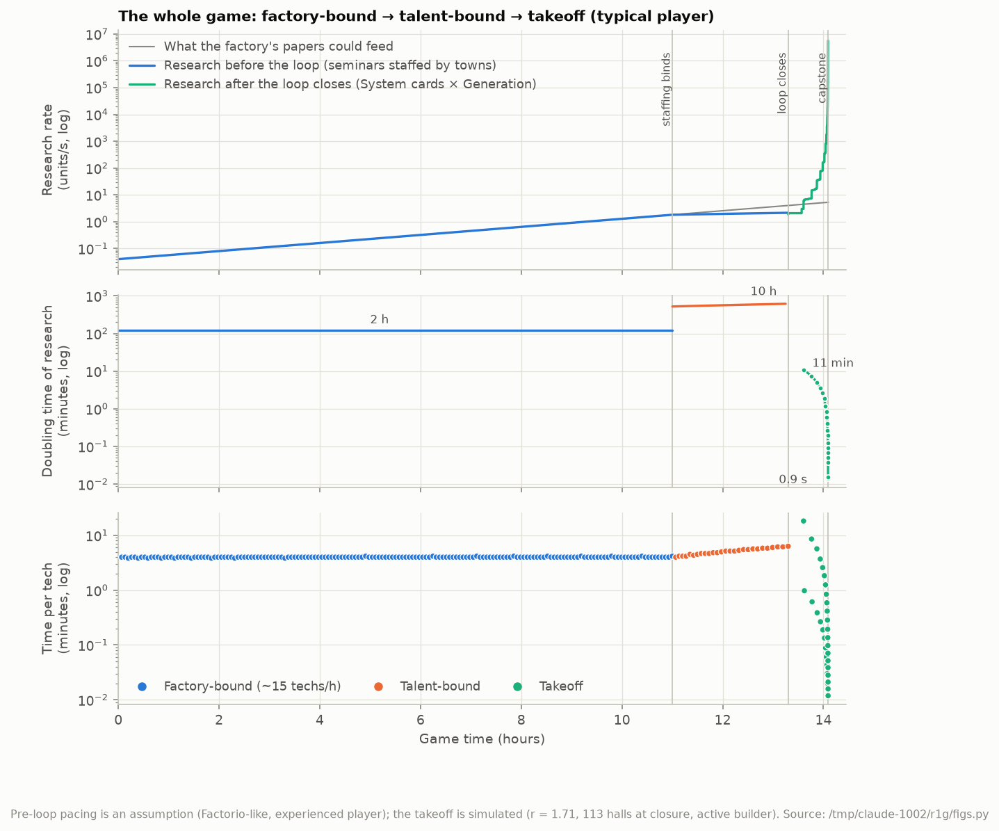
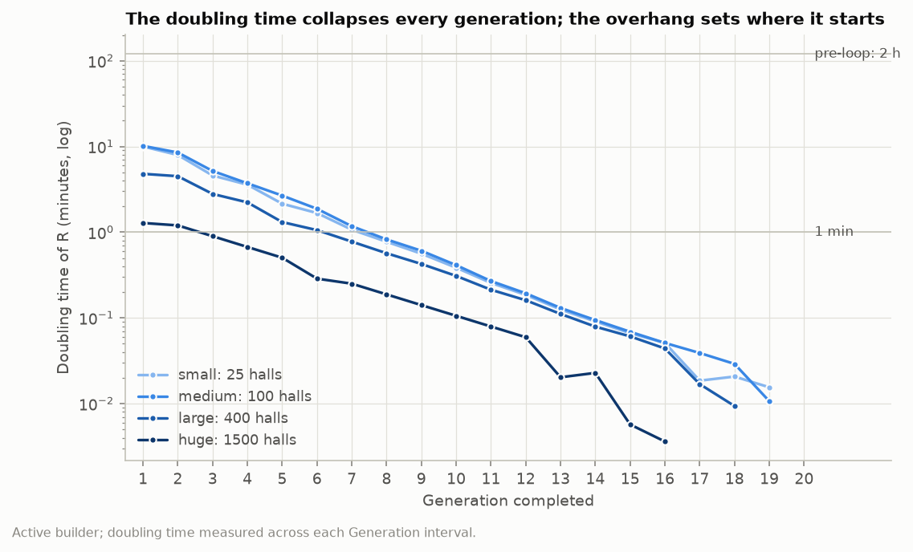
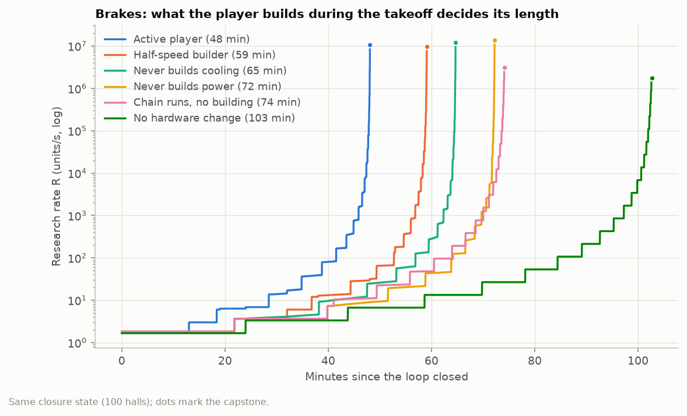
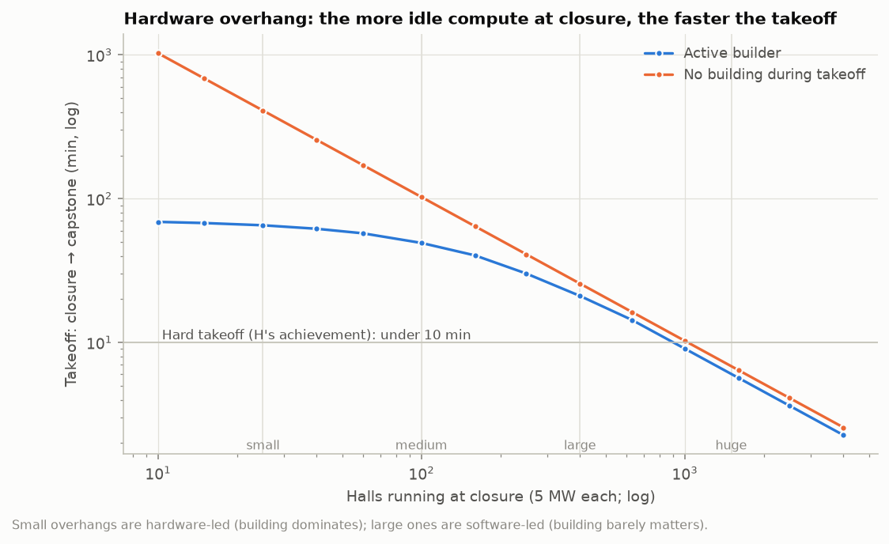
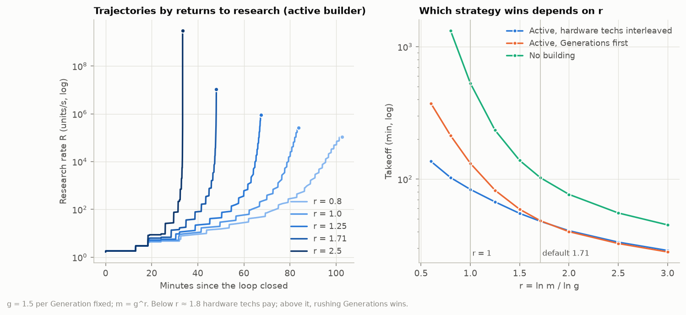
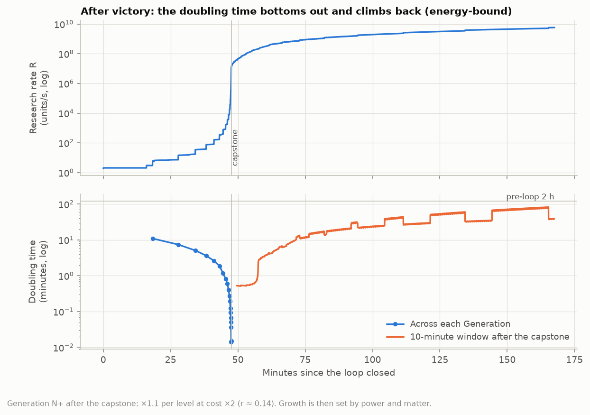
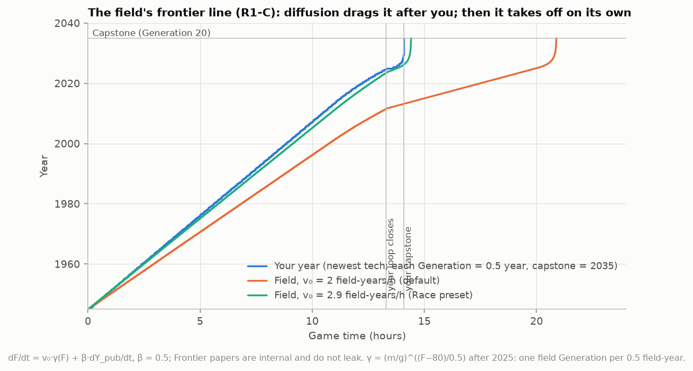

# R1-G: The late game and takeoff, with explicit math, simulated

*Round 1, agent G. Tags as in the brief: **ISO** keeps Factorio's mechanic, **BEND** is a small deliberate deviation, **BREAK** a large one.*

- **Names** follow H (`H-tone-bible.md`): Seminar (lab), System card (white pack), Researcher, Switch (beacon), Frontier cluster (silo), run shard.
- **Laws** follow B (`B-ontology.md`): L5 heat, L9 staff, L11 compute, L16 victory.
- **Heat numbers** follow F (`F-pressure.md` §1.1). The field line is C's (`C-spacetime.md` §5).
- **Simulation code** is in `/tmp/claude-1002/r1g/`: `takeoff.py` (model), `arc.py` (whole game, field line), `tune.py` (grid search), `figs.py` (every table and figure, about 20 s). **Figures** are in `G-figures/`.

## 0. Verdict

**One production function, four regimes.** The game computes research as

> **R = W × Π(G)**

- **W** is the flow of System cards (white packs) consumed in seminars. It is physical: accelerator halls loaded with frontier weights make it, and power, heat, accelerators and seminar capacity cap it.
- **Π(G) = 2^G** is research per paper. Each **Generation** tech doubles it, globally and retroactively, the way Factorio's research bonuses work.

The game passes through four regimes, each with a different binding input:

| Regime | When | What binds | Doubling time of research |
|---|---|---|---|
| Factory-bound | Start to about 11 h | Papers the factory makes (Factorio, ISO) | ~2 h |
| Talent-bound | About 11 h to closure | Seminar staff from towns (B, L9) | ~10 h |
| Takeoff | Closure to capstone, about 48 min | Software outruns cost (r > 1); power, heat and accelerators brake it | 10 min, falling to 1 s |
| Energy-bound | After victory | Power and matter | 40–75 min, then the expansion |

**Returns to research.**
- Generation *N* costs 2,400 × 1.5^(N−1) units and doubles research per paper.
- r = ln 2 / ln 1.5 = **1.71**. At fixed hardware each Generation therefore takes 3/4 as long as the one before.
- Research then follows a finite-time singularity, R ∝ (t* − t)^(−r/(r−1)) = (t* − t)^(−2.41). The simulation reproduces the exponent to three decimals.
- The finite tree (20 Generations, 11 hardware techs and a capstone) truncates the singularity just before t*.

**The overhang** is the accelerators sitting in halls and storage when the first frontier run completes.
- The talent plateau creates it naturally. While staffing caps research, building compute costs nothing.
- Takeoff time scales as 1/overhang when the takeoff is software-led, and flattens when it is hardware-led.

**The brakes are physical, and they keep the player busy.**
- Power: compute is interruptible load (BEND).
- Heat: F's throttle.
- Accelerators and seminar throughput.
- In the reference takeoff the builder spends 40% of the time on power, 30% on cooling, 14% on accelerator lines, 10% on seminars and 6% on hall space.

**Victory.** The capstone (Generation 20 plus one) unlocks the final frontier run. Its completion shows H's run report. *Objective, inferred* stays unconditional, as H argues: it is a mirror, not a verdict.
- **Alternative endings:** Race mode (the field's line reaches Generation 20 first), and the sandbox (never close the loop).
- **After victory:** Generations end, *Research productivity* (H #37) and *Energy per operation* continue with r ≈ 0, and growth becomes energy-bound. That leads into the expansion: launch site, orbit, Mercury, cold moons (B L16).

**Targets versus simulation** (reference: 100 halls at closure, active builder, r = 1.71):

| Target | Result |
|---|---|
| The regime change is felt | The research doubling time goes 2 h → 10 h on the plateau → **10.0 min** at Generation 1 → **0.99 s** at Generation 20. The readout halves every ~2.4 Generations (G1, G3) |
| The last ~20 techs fall in minutes | Last 20 of 32: **4.4 min**. Last 10: **41 s**. Peak **720 technologies/h** over the best minute, **156/h** over the best 10 minutes |
| Braked by physical limits; the player has things to do | Takeoff **48 min** active; **103 min** with no building (2.14×). Never building cooling costs 1.34×, never building power 1.50×. Power, cooling and accelerators each bind about a third of the time (G2, G6) |
| The overhang measurably changes takeoff speed | 25 halls → 65 min; 100 → 49; 400 → 21; 1,500 → **6 min** (*Hard takeoff*). With no building: 411 → 7 min (G4) |
| The midgame is not trivialized | Generations need the first frontier run's weights. Before it, every research multiplier is Factorio's and bounded (§4.7). Rushing the loop with a small overhang gives a slow takeoff (65–69 min), not a shortcut |

## 1. Why Factorio's late game cannot take off, and what has to change

**Factorio already is a semi-endogenous growth model** (Jones, 1995).
- Labs are researchers built from output. Research raises production and research.
- But Factorio keeps the returns to research far below 1:
  - *Lab research speed* has six levels (+20, 30, 40, 50, 50, 60%, ×3.5 in total) and then stops.
  - Space Age's *Research productivity* adds +10% per level (additive) at a cost of 1,000 × 1.2^L (120 s per unit). The relative gain of each level tends to 0 while its cost grows 20%, so r → 0.
- So research grows only as fast as the player builds, which is why the megabase phase is a plateau. Report 03 puts it well: *an explosion needs a bottleneck to remove.*

**Three things have to be added. Each is small, and each is a mechanic, not a cutscene.**

1. **A bottleneck only research can remove: talent.** Seminars need staff, and staff live in towns (B, L9). Universities supply a slowly growing amount within commuting range, so late research stops scaling with the factory. The **Researcher** (H: four accelerators plus a checkpoint, the checkpoint returned) staffs a seminar anywhere and removes the cap.
2. **A research line whose gain per level outgrows its cost per level:** the Generation line, with gain m = 2 and cost growth g = 1.5, so r = ln m / ln g > 1.
3. **A physical input the player scales: compute,** together with the power and heat that limit it. The explosion is then braked by building, not by a timer.

**Mapping the takeoff literature onto game quantities:**

| Takeoff-model quantity (Davidson; Davidson & Houlden 2025; Aghion, Jones & Jones) | Game quantity |
|---|---|
| Cognitive labor (human researchers) | Seminar staff from towns (B L9); slowly growing, unbuildable |
| Cognitive labor (AI researchers) | Researchers in seminars, plus accelerator halls running weights |
| Experiment compute | Accelerator-hall throughput: W, in System cards per second |
| Software efficiency S | Π(G), research per paper |
| Returns to software R&D, r | ln m / ln g of the Generation line (default 1.71; a world setting) |
| Hardware overhang | Accelerators idle when the first frontier run completes |
| Compute and energy bottleneck | Power (interruptible load), heat (F's throttle), accelerator lines |
| Software ceiling | The end of the Generation line. After it, Research productivity runs at r ≈ 0 |

On calibration: Davidson & Houlden (Forethought, 2025) estimate 0.4 < r < 3.6 with a median of 1.2, and later critiques put it lower. The default of 1.71 is on the fast side on purpose, for feel. Section 4.6 shows the game at r = 0.6–3.0 and how the best strategy changes with r.

## 2. The model the game simulates

### 2.1 Entities

| Entity | Role in the takeoff | Shape | Tag |
|---|---|---|---|
| **Seminar** (lab) | Consumes papers and turns them into progress | 3×3, 60 kW, speed 1, 2 module slots; lab-speed levels ×3.5; Switches (beacons) apply | ISO |
| Staff slot on the seminar | Holds one Researcher. Without one, the seminar draws town staff (B L9) | One slot, like a module slot | BEND (B's) |
| **Researcher** (H) | Staffs a seminar anywhere. A computing machine: it draws 0.5 MW, emits heat and throttles (F) | 4 accelerators + 1 frontier checkpoint (returned) | ISO recipe shape (Kovarex catalyst) |
| **Accelerator hall** (F's top computing machine, T* 25 °C) | Runs the *Run* recipe with frontier weights loaded: 60 s at speed 1 → 1 System card | Speed and power by accelerator tier (table below); modules and Switches apply as on any machine | ISO (assembler shape) |
| **Weights** | Copy of the frontier checkpoint, in the hall's weights slot | Copy recipe: master (returned) + blank drive → copy (B's copy law) | ISO (catalyst) |
| **Frontier cluster** (silo, 9×9) | 1st run: returns the frontier checkpoint and closes the loop. Final run, after the capstone: victory | 100 run shards + post-training payload (H) | ISO |
| **System card** (white pack) | The only pack the takeoff techs cost | Made by runs | ISO (space science's slot) |
| **Generation 1–20** | Research per paper ×2 each, global, retroactive | One numbered tech line | BEND (r > 1) |
| Power for compute | Computing machines take power only after every other consumer is satisfied | A consumer priority class | BEND |
| Cooling | F's tower (10 MW), dry cooler (20 MW), water exchanger (50 MW) | F §1.1 | F's BEND |

**Accelerator hall calibration.** A hall loaded at a given tier draws its full power whether or not heat throttles it (F).

| Tier | Speed | Power (MW) | Speed per MW | Unlocked by |
|---|---|---|---|---|
| 1 | 1 | 5 | 0.20 | pre-loop |
| 2 | 3 | 8 | 0.38 | *Accelerator 2* |
| 3 | 8 | 12 | 0.67 | *Accelerator 3* |
| 4 | 20 | 16 | 1.25 | *Accelerator 4* |

- Loading a hall takes 20 accelerators.
- New accelerators upgrade the oldest halls in place before they fill new halls. This is the upgrade planner, and H's *Weight transplant*: the old accelerators come back.
- D owns the item granularity (cards in module slots, per B L11, or whole racks). The takeoff needs only the speed and power columns.

### 2.2 The production function (exact)

**Per computing network, every tick.**

Power (BEND: compute is interruptible load):
```
D      = Σ_halls p_tier · pmult · (1 + module energy) + Σ_Researchers 0.5 MW
P_comp = max(0, P_generated − P_other)
u_p    = min(1, P_comp / D)            # Factorio's satisfaction, applied to compute only
```

Heat (F §1.1, per hall):
```
heat into the chunk = u_p · p (MW)     # throttling does not reduce the draw
m_h = clamp(1 − (T_chunk − T*)/50 K, 0.5, 1)
v_h = s_tier · (1 + Σ module and Switch speed) · u_p · m_h
```

System cards:
```
W_made = Σ_halls v_h / 60 s
```

Seminars (ISO apart from Π and staffing):
```
v_s      = (1 + B_speed) · (1 + Σ module and Switch speed) · staff_s · m_h(s)
           # m_h(s) applies only if a Researcher staffs the seminar
staff_s  = 1 with a Researcher, else min(1, S_town / demand_town)       (B L9)
W_used   = min(W_made, Σ_seminars v_s / T_unit)                        # T_unit = 30 s per unit
R        = W_used · (1 − h) · Π
Π        = 2^G · (1 + 0.1·L_rp) · (1 + Σ productivity modules)
h        = min(0.5, 0.1 · max(0, A − O)) · (1 − v)                     (F's hollow work)
```

- Generation *N* costs C_N = 2,400 × 1.5^(N−1) units at 30 s per unit, one System card per unit, and sets G := N.
- In the aggregate simulation, F's chunk field becomes m_h = clamp(Q / (u_p·D), 0.5, 1), where Q is the active cooling capacity. With no active cooling, heat throttles halls to half speed: F's calibrated floor for a 1 GW air-cooled campus.

### 2.3 Returns to research: closed forms (design rules for E)

With constant compute W₀ cards/s:

1. **Generation intervals shrink geometrically.**
   - τ_j = C_j / (W₀·2^(j−1)) = τ₁·q^(j−1), with q = g/m = 0.75.
   - τ₁ = C₁/W₀. For the reference, 2,400 units ÷ 1.67 cards/s = 1,440 s = 24 min.
2. **Takeoff length at fixed hardware.**
   - T = τ₁ · [Σ_{j≤20} q^(j−1) + (φ/m) · Σ_{j≤11} q^(j−1)] + τ_cap = τ₁ · (3.99 + 0.29) + 5 s ≈ 4.28 τ₁ = 102.6 min.
   - φ = 0.15 is a hardware tech's cost relative to the Generation before it. It is researched at that Generation's doubled rate, hence φ/m.
   - The simulation gives 102.7 min. For an unbounded tree with no hardware techs, T → τ₁/(1 − q) = 4τ₁ exactly (simulated: 96.0 min against 96.0).
3. **Finite-time singularity.**
   - R ∝ (t* − t)^(−ln m / ln(m/g)) = (t* − t)^(−r/(r−1)).
   - At r = 1.71 the exponent is −2.41 (fitted from simulation: −2.409).
   - As r → 1⁺ the exponent grows and t* recedes to infinity. At r = 1 every Generation takes equally long (exponential growth); below 1 each takes longer.
4. **The doubling-time readout halves every ln 2 / ln(1/q) ≈ 2.4 Generations.**
   - The doubling time across Generation j is τ_j·ln 2 / ln m = τ_j at m = 2.
5. **Design rule.** To make Generation 1 take τ₁ at a typical closure flow W₀, set C₁ = τ₁·W₀.
   - Everything else follows from q. The whole takeoff consumes only about **10,000 System cards**, because Π grows as fast as the costs.
6. **Overhang.** At fixed hardware, T ∝ 1/W₀ ∝ 1/(halls at closure). Building during the takeoff bends the curve (§4.5).

### 2.4 Talent and the plateau (B's L9 made into numbers)

- Before the loop, seminars run at speed × min(1, staff supply ÷ demand) within commuting range of towns. That range is B's 48 tiles.
- Supply grows as you claim universities and as the world level W raises each university's T. In the stylized pre-loop model, staffing starts to bind at about 11 h. Capped research then grows about 8% per hour, so the doubling time jumps from 2 h to 9–10 h (G1).
- **Why the cap exists.** It makes research, uniquely, an input you cannot build, and so it creates the bottleneck that the Researcher removes.
  - Everything else in the factory still scales by building (ISO).
  - Lab speed (Switches, modules) still raises output per staffed seminar, so the cap is soft, as B intends.
- **Why it makes the overhang.** On the plateau, building compute is free: the player is waiting for capped research anyway.
  - The Researcher recipe needs the **frontier checkpoint**, which only the first frontier run returns. So the cap lifts at closure, even if *Automated research* was researched earlier (H puts #36 before #38).
  - This reconciles H's ordering with B's L16: "completion yields the first machine researcher."
- **Researchers do not multiply research per paper.** They only staff seminars, so they cannot speed up the midgame.

### 2.5 The overhang

- **Definition (the run report's stat):** accelerators in computing machines plus accelerators in storage, at the moment the first frontier run completes. The reference has 3,000: 100 halls × 20, plus 1,000 stocked.
- **The moment.** The run lands and its master checkpoint is copied onto blank drives. Agents carry weights to every waiting hall and Researchers to every seminar.
  - Within one or two minutes, System cards start flowing at W₀ (1.67/s in the reference), and the staffing cap on material research lifts (2.0 → 2.9 units/s in the pre-loop model).
  - From then on, research on the takeoff techs doubles with every Generation. This is the hardware overhang made visible, without a cutscene.
- **Launch delay.** Waiting past the plateau to grow the overhang always shortens the takeoff and lengthens the game (§4.5). That is the honest form of the debate: a pause makes takeoff faster when it ends.

### 2.6 The brakes (exact rules)

| Brake | Rule | Player's answer | Tag |
|---|---|---|---|
| **Power** | Computing machines are *interruptible load*: u_p = min(1, P_comp / D) applies to them alone. A shortfall slows research, never the factory | Nuclear blocks (480 MW); after *Fusion power*, fusion blocks; solar (adds no heat, F) | BEND |
| **Heat** | F's chunk field and throttle (floor 0.5, T* 25 °C for halls, +15 K liquid-cooled). A throttled hall still draws full power | Towers, dry coolers, water exchangers; cold sites; spacing; *Two-phase* and *Microfluidic cooling* | F's BEND |
| **Accelerators** | A hall needs 20. The tier sets speed and power. Upgrades replace the oldest first | Accelerator lines (the deep chip chain); *Nanofabrication* | ISO |
| **Seminar throughput** (routing) | W_used = min(W_made, Σ seminar capacity). Each seminar needs a Researcher and a belt or agent supply of System cards | Seminar blocks with Researchers and Switches | ISO |
| **Hollow work** (F §3) | Researcher-staffed seminars waste a share h of cards when model tier exceeds Oversight | *Oversight 1–4*, *Interpretability*, checkpoint quality | F's BEND |

- **Why power is a BEND.** In Factorio, a brownout slows every machine, including the ones that build power plants. During a takeoff that would cause a death spiral and turn a brake into a punishment.
- Interruptible compute is how real datacenters are being integrated into grids: demand response and curtailable load. A Factorio player reads it as "research speed = spare power", a gauge they already know.
- The engine needs one more consumer priority class, alongside Factorio's existing input priorities.

### 2.7 Ledger

| Element | Tag | Fun bought |
|---|---|---|
| Seminars, packs, lab speed, modules, Switches, silo, rocket parts | ISO | Veterans' intuitions transfer unchanged |
| Generation line, r > 1 | BEND | The regime change: the one deviation the endgame is for |
| Staffing cap before the loop (B) | BEND | The bottleneck the explosion removes; creates the overhang |
| Interruptible compute | BEND | A brake without a death spiral |
| Heat throttle (F) | BEND | The physical brake that scales with density |
| White pack produced continuously by halls after the first run | BEND (space science came from launches) | Fine-grained scaling during takeoff (§7) |

## 3. The takeoff tree (for R1-E)

Every takeoff tech costs only System cards, at 30 s per unit, one card per unit. In the default order, one hardware tech follows each of the first 11 Generations. Times are from the reference run.

| # | Tech | Cost (units) | Effect | Done at |
|---|---|---|---|---|
| 1 | Generation 1 | 2,400 | Research per paper ×2 (all seminars, retroactive) | 18.4 min |
| 2 | Two-phase cooling | 360 | Cooling built per block ×2 | 19.4 |
| 3 | Generation 2 | 3,600 | ×2 | 28.5 |
| 4 | Accelerator 2 | 540 | Hall tier 2 (speed 3, 8 MW) | 29.1 |
| 5 | Generation 3 | 5,400 | ×2 | 34.8 |
| 6 | Fleet scheduling | 810 | Construction ×2 (agent speed and planning) | 35.2 |
| 7 | Generation 4 | 8,100 | ×2 | 38.8 |
| 8 | Fusion power | 1,215 | Fusion block: 2.4 GW per build, against nuclear's 480 MW | 39.0 |
| 9 | Generation 5 | 12,150 | ×2 | 41.5 |
| 10 | Sparse inference | 1,823 | Hall power ×0.75 (retroactive) | 41.7 |
| 11 | Generation 6 | 18,225 | ×2 | 43.5 |
| 12 | Accelerator 3 | 2,734 | Tier 3 (speed 8, 12 MW) | 43.6 |
| 13 | Generation 7 | 27,338 | ×2 | 44.9 |
| 14 | Microfluidic cooling | 4,101 | Cooling per block ×2 (Tuckerman & Pease, 1981) | 45.0 |
| 15 | Generation 8 | 41,006 | ×2 | 45.9 |
| 16 | Deployer | 6,151 | Construction ×2, two builds at once: the factory places its own blueprints (a building that deploys blueprints on circuit command) | 45.9 |
| 17 | Generation 9 | 61,509 | ×2 | 46.6 |
| 18 | Nanofabrication | 9,226 | Accelerator lines ×2 (retroactive); new lines ×3 | 46.6 |
| 19 | Generation 10 | 92,264 | ×2 | 47.1 |
| 20 | Accelerator 4 | 13,840 | Tier 4 (speed 20, 16 MW) | 47.1 |
| 21 | Generation 11 | 138,396 | ×2 | 47.4 |
| 22 | Reversible logic | 20,759 | Hall power ×0.5 (retroactive; Bennett, 1973) | 47.4 |
| 23–31 | Generations 12–20 | 207,594 … 5,320,403 | ×2 each | 47.6 → 48.07 |
| 32 | Capstone | 7,980,604 | Unlocks the final payload | **48.08** |

**Pre-loop gates** (E's ordering; H's numbers in parentheses):
- *Automated research* (#36) unlocks the Researcher. The recipe still needs the frontier checkpoint.
- *Research productivity* (#37) is infinite, +10% per level at ×2 cost per level.
- *Frontier training* (#38) unlocks the Frontier cluster and run shards.
- *Weight transplant* (#40) is the in-place hall upgrade.
- ***Research scheduling* (#41) belongs before the loop.** The queue holds 7 entries (I), and the last 10 techs complete in 41 s. Without the queue filling itself, the human clicking it becomes the bottleneck: true, but tedious.
- *Synthetic curriculum* (#39) can stay where H put it.

**Hardware techs are a deliberate choice, not filler.** They cost 15% of the Generation before them and only pay off if the player builds what they unlock. Whether they are worth researching depends on r (§4.6). That is the takeoff debate as a strategy the player discovers.

## 4. Simulation

### 4.1 What is simulated

- **The takeoff, second by second.**
  - Labs, halls, power, heat (aggregate F throttle), accelerator supply, seminar capacity and the tech queue.
  - Techs complete exactly within a tick: R is piecewise constant, and sub-second completions carry over.
- **The player.**
  - A single builder works one task at a time; two after *Deployer*.
  - Each time it is free, it picks the resource with the highest projected pressure over the next 6 minutes (need ÷ capacity), or else grows accelerator supply.
  - Agents place halls automatically as accelerators arrive, into laid-out free slots. Materials are assumed available.
- **Task calibration** (base time, scaled by construction bonuses):

| Task | Time | Adds |
|---|---|---|
| Nuclear block (2×2 reactors) | 8 min | +480 MW |
| Fusion block (after *Fusion power*) | 8 min | +2,400 MW |
| Cooling block | 5 min | +400 MW (×2 after *Two-phase*, ×4 after *Microfluidic*) |
| Accelerator line | 10 min | +40 accelerators/min (×3 after *Nanofabrication*) |
| Hall block (space, wiring) | 3 min | +100 hall slots |
| Seminar block (with Researchers and Switches) | 3 min | +5 cards/s of capacity |

- **Reference closure state:**
  - 100 tier-1 halls running (500 MW);
  - 1,000 accelerators stocked and 100 free hall slots;
  - 50 MW of spare power and 50 MW of spare cooling;
  - accelerator supply of 60/min;
  - 800 MW of non-compute load.
- **Pre-loop pacing is an assumption** standing in for E's tree: research doubling every 2 h, about 15 techs per hour, and staffing binding at 11 h (`arc.py`).

### 4.2 The reference takeoff



| Phase | Minutes | What happens |
|---|---|---|
| Closure | 0 | Weights reach 100 halls and Researchers reach the seminars; the 1,000 stocked accelerators become 50 more halls at once |
| Power wall | 0–8 | 150 halls want 750 MW against 550 available; compute throttles to 73%. The builder lays a nuclear block |
| Cooling wall | 8–24 | Halls keep arriving at 3 per minute; F's throttle binds; cooling blocks go down |
| Generation 1 | 18 | Research ×2; doubling time **10 min** |
| Power, then compute | 24–34 | Accelerator 2 starts an upgrade wave; power binds again, then compute |
| Acceleration | 34–45 | Generations every 6 → 1 min; Fusion, Sparse inference and Accelerator 3 arrive faster than they can be built |
| The cascade | 45–48 | Generations 8–20 and the capstone: **the last 20 techs in 4.4 min, the last 10 in 41 s** |

The doubling time per Generation:

| Generation | 1 | 2 | 3 | 4 | 5 | 6 | 7 | 8 | 9 | 10 | 12 | 14 | 16 | 18 | 20 |
|---|---|---|---|---|---|---|---|---|---|---|---|---|---|---|---|
| Doubling time | 10.0 min | 8.4 min | 4.6 min | 3.5 min | 2.6 min | 1.9 min | 75 s | 54 s | 38 s | 26 s | 12 s | 6 s | 3 s | 2 s | 0.99 s |

Research rose from 1.67 to 1.1 × 10⁷ units/s. Halls went from 100 to 237, of which 68 were upgraded in place to tiers 2–4 by the end (upgrade waves are slow: a full tier swap of 237 halls needs 4,740 accelerators). Power for compute went from 550 to 1,990 MW.

### 4.3 The regime change is felt



- **On a linear time axis, the takeoff is a vertical line.**
  - The doubling time readout goes 2 h → 10 h on the talent plateau → 10 min → 1 s.
  - Time per tech goes ~4 min → ~6 min on the plateau → 18 min (Generation 1 is a wall of its own) → under a second.
- **The plateau is what makes the contrast.** For about two hours, research barely grows however much the player builds: the felt version of "ideas are getting harder to find with a fixed number of researchers."
- **Doubling times in the four overhang scenarios** (G3):

| Overhang | Halls at closure | First doubling time | Final doubling time |
|---|---|---|---|
| small | 25 | 10.0 min | 0.93 s |
| medium | 100 | 10.2 min | 0.64 s |
| large | 400 | 4.8 min | 0.56 s |
| huge | 1,500 | 77 s | 0.22 s |



### 4.4 The brakes give the player things to do



| Builder | Takeoff (min) | vs active | Last 20 techs (min) | Time bound by compute / power / cooling / labs |
|---|---|---|---|---|
| Active player | 48.1 | 1.00× | 4.4 | 33 / 33 / 32 / 1 % |
| Half-speed builder | 59.1 | 1.23× | 4.3 | 4 / 68 / 27 / 1 % |
| Never builds cooling | 64.7 | 1.34× | 5.0 | 0 / 12 / 88 / 0 % |
| Never builds power | 72.2 | 1.50× | 5.5 | 0 / 100 / 0 / 0 % |
| Accelerator supply runs, nothing built | 74.1 | 1.54× | 9.9 | 0 / 100 / 0 / 0 % |
| No hardware change at all | 102.7 | 2.14× | 17.8 | 100 / 0 / 0 / 0 % |

- **Power and cooling are complements,** as a Factorio recipe is Leontief. Building only one of them buys almost nothing: "never builds cooling" is almost as slow as building nothing.
- **What dominates the builder's time:** power 40%, cooling 30%, accelerator lines 14%, seminars 10%, hall space 6%. This is the 2026 datacenter siting game played at Factorio speed.
- **The cascade is spectacle, and the hour before it is play.** Since the last ~10% of the takeoff is spectacle, the payoff stays short and earned.

### 4.5 The overhang changes takeoff speed



| Halls at closure | 10 | 25 | 40 | 100 | 160 | 250 | 400 | 630 | 1,000 | 1,600 | 4,000 |
|---|---|---|---|---|---|---|---|---|---|---|---|
| Takeoff, active (min) | 69 | 65 | 62 | 49 | 40 | 30 | 21 | 14 | 9.1 | 5.7 | 2.3 |
| Takeoff, no building (min) | 1,027 | 411 | 257 | 103 | 64 | 41 | 26 | 16 | 10.3 | 6.4 | 2.6 |

- **Small overhangs are hardware-led.** Building dominates and the takeoff is slow: the slow-takeoff world.
- **Large overhangs are software-led.** Building hardly matters and the takeoff is fast. The curve is the debate.
- **The plateau decides the overhang** (pre-loop model; staffing binds at 11 h):

| Plateau play | Plateau (min) | Halls at closure | Takeoff (min) | Capstone at |
|---|---|---|---|---|
| Typical: 0.6 halls/min | 138 | 113 | 47.5 | 14.09 h |
| Idle: 0.2 halls/min | 138 | 58 | 57.9 | 14.26 h |
| Compute-first: 1.5 halls/min | 138 | 237 | 31.3 | 13.82 h |
| Talent-first: claim universities twice as fast | 129 | 107 | 48.5 | 13.95 h |
| Talent-first and compute-first | 129 | 223 | 32.6 | **13.69 h** |
| Compute-first, launch 30 min late | 168 | 282 | 27.6 | 14.26 h |
| Compute-first, launch 90 min late | 228 | 372 | 22.3 | 15.17 h |

- **Using the forced wait** to build compute and claim towns saves 24 minutes.
- **Delaying the launch** shortens the takeoff and always lengthens the game.
- ***Hard takeoff*** (H: under 10 min) needs about 1,000 halls idle at closure: 5 GW and 20,000 accelerators, a deliberate megaproject.
- ***Slow takeoff*** (over 2 h) needs a small overhang and passive play, or r ≤ 0.6.

### 4.6 Returns to research, and which strategy wins



g = 1.5 is fixed and m = g^r. "Interleaved" researches a hardware tech after each Generation; "Generations first" researches the hardware techs last.

| r | m | Active, interleaved (min) | Active, Generations first (min) | No building (min) | Last 20 techs (min) |
|---|---|---|---|---|---|
| 0.6 | 1.28 | 136 | 373 | never | 57 |
| 0.8 | 1.38 | 103 | 213 | 1,320 | 33 |
| 1.0 | 1.50 | 84 | 132 | 530 | 21 |
| 1.25 | 1.66 | 67 | 82 | 234 | 12.5 |
| 1.5 | 1.84 | 55 | 59 | 138 | 7.0 |
| **1.71** | **2.00** | **48** | **49** | **103** | **4.4** |
| 2.0 | 2.25 | 41 | 40 | 77 | 2.1 |
| 2.5 | 2.76 | 33 | 33 | 56 | 0.5 |
| 3.0 | 3.38 | 29 | 28 | 45 | 0.1 |

- **The best strategy depends on r.**
  - At r ≤ 1.25, investing in hardware techs and building wins by a wide margin (84 against 132 min at r = 1).
  - Around the default the two strategies tie.
  - Above r ≈ 2, rushing Generations wins.
- **No speech is needed.** Expose r as a map setting, *Returns to research*: presets 1.0, 1.2 (the published median), 1.71 (default) and 2.5. The game acts out the fast-versus-slow debate and leaves the verdict to the player's stopwatch.

### 4.7 The midgame is not trivialized

1. **No Π before the loop.** Generations cost System cards, and System cards need weights from the first frontier run. Before that, every research multiplier is Factorio's:
   - lab speed ×3.5 at most;
   - modules and Switches;
   - *Research productivity* at +10% per level with doubling cost. That is bounded in practice: level 5 alone costs 32 times level 0.
2. **Researchers staff, they do not multiply.** Lifting the talent cap restores factory-bound research. Nothing more.
3. **Rushing the loop is not a shortcut.** With a small overhang the takeoff takes 65–69 min even with active building (§4.5), and the frontier run itself (100 run shards) is late-game production, as Factorio's rocket is.
4. **The takeoff costs no material packs.** The red–yellow factory is never asked to grow exponentially, so the matter economy stays Factorio's. What the takeoff demands from matter is power plants, coolers and accelerators: the physical brakes.
5. **Hardware techs that change the economy arrive only after closure:** fusion, nanofabrication, construction ×4.

### 4.8 Sensitivities and limits

| Variation | Takeoff (min) |
|---|---|
| Reference | 48.1 |
| F's hollow work h = 0.2 (no Oversight) | 55.2 (+15%) |
| Hollow work h = 0.5 | 73.9 (+54%) |
| Without hardware techs (Generations only) | 48.5: at the default r they barely repay their cost; at r ≤ 1.25 they decide the takeoff (§4.6) |
| Heat with no floor (u = min(1, Q/D)) | 48.1 for the active builder; neglecting cooling would cost 1.53× instead of 1.34× |

- **Hollow work makes Oversight pay off in time.** It turns *Oversight* and *Interpretability* into takeoff accelerators, not an alignment tax. That is closer to RLHF's history than the tax framing, and the game never says so.
- **What the simulation does not model:**
  - spatial heat (F's chunk field makes density matter more, so it is likely a stronger brake than the aggregate);
  - material supply for builds;
  - logistics latency;
  - several players' worth of attention.
- **What is robust and what is not.** The ratios (overhang, brakes, r) are robust. The absolute minutes depend on the task calibration above, and round 3's balance pass should re-run `tune.py` against D's real recipes.

## 5. Victory, endings, and after victory

### 5.1 Victory (ISO with the rocket)

- **The capstone** is the tech after Generation 20 (7.98 M units, a fraction of a second at that point).
- **It unlocks the final run's payload.** When the next frontier run completes, the game shows H's **run report**, in the typography of the production-statistics screen. That is the victory. This is BEND to H's trigger, which was "the first frontier run after closure"; the first run is now what closes the loop.
- **The report's fields, as G measures them:**
  - **Loop closed:** game time of the first run's completion.
  - **Takeoff:** closure → capstone. Reference 48:05.
  - **Overhang at closure:** accelerators in computing machines and storage. Reference 3,000.
  - **Peak research rate:** technologies per hour over the best 10-minute window. Reference 156.
  - **Most-produced item** and **Objective, inferred:** unconditional, exactly as H wrote them.
  - Optional extra line: **Fastest doubling**, 0.99 s.
- **Capstone name: H's call.** The exact historical term is *Ultraintelligent machine*, with Good's 1965 definition as the whole description: "a machine that can far surpass all the intellectual activities of any man however clever."
  - This collides with H's ban on "intelligent" in UI text. Either H allows the citation-exact concept name, or the capstone takes a plainer name such as *Frontier training 2*.
  - H already uses *The last invention* for Automated research.

### 5.2 Alternative endings

1. **Run report** (default). Play continues, as after Factorio's rocket.
2. **Race (opt-in; C and F).** You lose if the field's line reaches its Generation 20 (F ≥ 90, i.e. 2035 in field-years) before your capstone.
   - The game then shows H's line: "A frontier run completed elsewhere at 29:40:11. Yours was at 61%." The report follows, and play continues.
   - This restates C's rule (W > your year for 10 minutes) in a form where both sides count Generations (§5.5).
3. **Sandbox.** Never fly the first frontier run. The game stays Factorio, with r ≈ 0 forever; Research productivity is the only infinite research.

**No ending is conditioned on alignment.** H's argument holds: a choice with a correct answer is a sermon. Safety enters as mechanics, all with measurable effects on the takeoff:
- hollow work;
- escapes, i.e. F's runaways;
- checkpoint quality, i.e. verifiers.

### 5.3 Infinite technologies

**Rule (BEND from Factorio's arithmetic mining productivity): every infinite tech has geometric cost, at least ×1.5 per level.**
- After takeoff, research runs about 10⁶ times faster than before the loop.
- A linear cost curve such as 2,500 × L would then yield thousands of levels in minutes. A geometric one yields log₂(R·t) levels: a burst of about 30 levels, then one level per doubling of time.

| Infinite tech | Effect per level | Cost (units) | Note |
|---|---|---|---|
| Research productivity (H #37) | +10% research per paper (additive, global) | 1,000 × 2^L, all packs incl. System card | Available before the loop; bounded there. After the capstone it is the software ceiling: r ≈ 0 |
| Energy per operation | Hall and Researcher power × [f + (1 − f)·0.9^L] | 1,000 × 2^L System cards | f = T_site / 4,800 K, so the floor is 1/16 of starting power at 300 K. Landauer: energy per irreversible bit is kT ln 2. Lower at cold sites: a 40 K moon gives f ≈ 1/120 |
| Archive yield (H, mining-productivity analog) | +10% | 1.5^L × 1,000 | Geometric, per the rule |
| Agent speed (worker robot speed) | +65% (Factorio's level 6+) | 2^(L−6) × 1,000 | ISO |
| Thermal management (F) | +10% tower capacity | 1.5^L × 1,000 | F's |

### 5.4 After victory: the bridge to the expansion



- **The doubling time bottoms out at the capstone and climbs back:**

| After the capstone | +0 | +10 min | +20 | +30 | +60 | +115 |
|---|---|---|---|---|---|---|
| Doubling time of research | 33 s | 2.4 min | 6.6 min | 15 min | 41 min | 75 min |
| Power for compute (GW) | 1.6 | 4.0 | 6.4 | 8.8 | 16.0 | 37.6 |

- **Research becomes energy-bound.**
  - The software is at its ceiling, and the agent-built factory doubles its power every 30–40 minutes.
  - *Energy per operation* approaches a floor set by the site's temperature.
- **The bridge.** The continent's power and matter are finite, so the only way up is off it.
  - This is B's L16: the expansion's first building is a literal launch site, leading to orbit (sun without night), the Moon and asteroid belt, Mercury's swarm, and cold outer moons, where the Landauer floor is lower.
  - The Seed (report 03) is the expansion's opening payload. H's line when it lands: `Landed. Blueprint library: 1 entry.`
- **The arc.** Matter-bound → talent-bound → software-bound → energy-bound: each regime has a different binding input, and the game's own statistics show the transition every time.

### 5.5 The field's frontier line and Race mode (C §5, F §3)



- **Equation:** dF/dt = v₀·γ(F) + β·dY_pub/dt.
- **Symbols:**
  - F is field-years since 1945, B's W.
  - Y_pub is your year from *published* techs: every material-pack tech.
  - System cards never leak: frontier work is internal.
  - β = 0.5: you publish one year, the field gains half.
- **The field's own takeoff.** γ = 1 until F reaches 80 (2025, the field's loop). After that, γ = (m/g)^((F − 80)/0.5): one field Generation per half field-year, with the same q as yours. The field therefore takes off on its own: its own takeoff lasts about 0.5/(v₀·ln(m/g)) hours.
- **Your year during takeoff** is 2025 + 0.5 per Generation, so the capstone is 2035, which is the field's F_cap = 90. Both lines count the same thing.
- **Typical player** (closure 13.3 h, capstone 14.09 h):

| v₀ (field-years/h) | Field year at your closure | Field loop closes | Field reaches Generation 20 | First to finish |
|---|---|---|---|---|
| **2.0 (default)** | 2012 | 20.0 h | 20.9 h | you, by 6.8 h |
| 2.5 | 2018 | 16.0 h | 16.7 h | you, by 2.6 h |
| 2.75 | 2022 | 14.5 h | 15.2 h | you, by 66 min |
| **2.9 (Race)** | 2024 | 13.8 h | 14.4 h | you, by 19 min |
| 3.0 (Race, hard) | 2025 | 13.3 h | 13.9 h | the field, by 10 min. Compute-first plateau play wins by 6 min; talent- and compute-first wins by 14 min (§4.5) |

## 6. Parameters and hand-offs

**R1-E (tech tree).**
- §3's table: costs, order, effects, and 30 s per unit.
- Pre-loop pacing assumed here: about 15 techs/h, research doubling every 2 h, staffing binding with about 25–30 techs left, and a plateau of about 2–2.5 h.
- Last pre-loop techs: *Automated research*, *Frontier training*, *Research scheduling*, *Weight transplant*.
- Lab speed 1–6: ISO.
- *Research productivity* is infinite at ×2 cost.
- No infinite tech has arithmetic cost (§5.3).
- Give each takeoff tech a field-year (2025 + 0.5·G) so the field readout works.

**R1-D (production).**
- Hall tiers: speed 1/3/8/20 at 5/8/12/16 MW, 20 accelerators to load.
- Run recipe: 60 s → 1 System card, plus one curated-token drive (suggested).
- Researcher: 4 accelerators + frontier checkpoint (returned), 0.5 MW.
- Copying weights: master + blank drive → 2.
- Throughput at closure: 60 accelerators/min and about 3,000 accelerators idle. Power: 1.35 GW (800 MW factory + 550 MW compute) at closure, about 2.8 GW at the capstone.
- The takeoff wants a fusion building worth about 5× a nuclear block per build, and cooling buildings at F's sizes.

**R1-F (pressure).**
- Adopted: the throttle floor of 0.5, throttled halls drawing full power, and hollow work.
- Proposed for escapes during takeoff: halls with frontier weights and Researcher-staffed seminars count as deployment buildings. Their model tier is min(4, 1 + ⌊G/5⌋), so a fast takeoff raises the tier, which is F's stated intent, without letting 200 halls at Generation 20 flood the map.
- Typical rate under F's leak formula, integrated over the reference takeoff: 0.6 escapes with Verified checkpoints and 2 Oversight techs; 2.0 with Standard checkpoints and none. Something to contain, not a war.

**R1-C (field line).** §5.5's parameters:
- v₀ = 2.0 by default; 2.9 and 3.0 for Race.
- β = 0.5, with Frontier papers internal.
- y_gen = 0.5.
- F_auto = 80, F_cap = 90.

**R1-I (UI).**
- **Doubling-time readout.** In the research widget tooltip (I §4.10), computed from research *units* per second, not packs.
  - R̄ is progress over the last w seconds divided by w, with w = clamp(DT/4, 5 s, 120 s).
  - DT(t) = t − max{s : R̄(s) ≤ R̄(t)/2}.
  - H's history string (`40:00 → 20:00 → 5:00 → 1:10 → 0:12`) appends an entry each time DT halves.
- **Science graph.** Offer a log scale on the 10-minute science graph once the loop has closed.
- **Bonuses window.** "Research per paper ×1,024".
- **Compute satisfaction** goes on the power tooltip.
- **Staff overlay** (B) and **Heat overlay** (F).
- **Remaining-time estimate.** Factorio's estimate from the last minute will be wrong by 10× during takeoff, so H's *Hofstadter's law* achievement fires naturally.

**R1-H (tone).**
- Names used here: *Generation N*; *Two-phase cooling*; *Fleet scheduling*; *Sparse inference*; *Microfluidic cooling* (Tuckerman & Pease, 1981); *Deployer*; *Nanofabrication*; *Reversible logic* (Bennett, 1973); *Energy per operation* (Landauer, 1961).
- Option for the Generation line: start numbering at 6. Computer "generations" are a true 1950s term, and the Fifth Generation (1982) was the famous failed AI one. *Generation 6* is the first after it, and nothing needs to explain that.
- Achievement thresholds, measured from closure: *Hard takeoff* under 10 min needs about 5 GW idle; *Slow takeoff* over 2 h needs a small overhang and passive play, or r ≤ 0.6.

## 7. Disagreements, risks, open questions

- **With H's run-report trigger:** see §5.1. Same screen, later trigger. The first run closes the loop, as B's L16 says.
- **System cards come from halls, not only from launches.** Space science came only from launches.
  - Continuous production gives the takeoff fine-grained scaling (hundreds of halls) and no 9×9 granularity.
  - The fiction holds, because a run is a run at any size.
  - **Alternative:** only Frontier clusters return System cards, a batch per launch, as in Factorio 1.1 with 1,000 per satellite. The math is unchanged: a "hall" becomes 5 MW of Switch-boosted frontier-cluster compute. The takeoff gets coarser and more launch-driven. Integration can pick.
- **With the design-space doc's "universities as fixed-yield wells".** I first modelled talent as universities writing white papers at a fixed rate. B's staffing law does the same job without people producing items, and it keeps labs ISO until the plateau, so I switched. The takeoff math is identical: only the plateau's shape differs.
- **r = 1.71 is above the published median of 1.2.** It is chosen for feel. The world setting covers the honest range; at r = 1.2 the default takeoff is about 70 min.
- **The final ~40 s are spectacle.** That is accepted as the payoff, and *Research scheduling* must exist before it.
- **Material factories idle?** The takeoff costs no red–yellow packs, so those lines stop mattering after closure. But the factory is busy producing accelerators, power plants and coolers, which is where the brake is.
- **Aggregate heat and a single-builder model.** Round 3's balance agent should rerun `tune.py` with D's recipes and F's chunk field. The targets are written down in `tune.score()`.

## Appendix A — per-tick pseudocode (the takeoff part of the simulation)

```
each tick (dt = 1/60 s in game; 1 s in the sim):
  D   = Σ halls p_tier·pmult + Σ researchers 0.5          # MW
  u_p = min(1, (P_gen − P_other) / D)                     # interruptible compute
  for hall: m_h = clamp(1 − (T_chunk − T*)/50, 0.5, 1)    # F; emits u_p·p into its chunk
  W   = Σ hall s_tier·bonus·u_p·m_h / 60                  # System cards/s
  W   = min(W, Σ seminar v_s/30) · (1 − h)
  R   = W · 2^G · (1 + 0.1·L_rp)                          # units/s
  progress += R·dt; while progress ≥ cost(current): complete it (apply effect, G += 1 for Generations),
                                                          # carry the excess into the next tech
  accelerators += supply·dt; place/upgrade halls (oldest tier first, then free slots)
```

Reproduce every number and figure: `~/.local/opt/gamedev-py/bin/python /tmp/claude-1002/r1g/figs.py`. Tables go to `/tmp/claude-1002/r1g/out/tables.md`.
