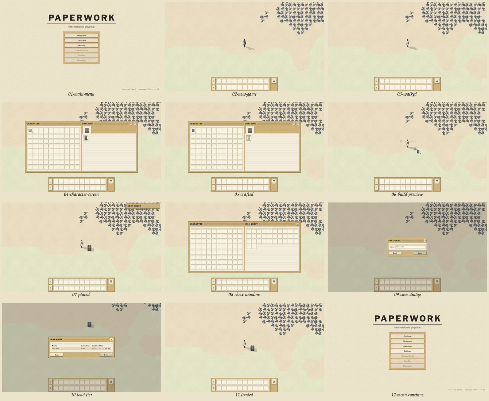

# C5: UI and input v0 (M0 UI package)
Status: done; codex C5-r1's findings answered (19 fixed, 1 deferred; the last section). Worktree branch
`worktree-agent-ae96100183e0c648f`: the first round's four commits on `dev` (d2c709f), then `dev` merged (C2c, C3, C4,
C7; 6378c68) and the review's fixes. The UI now runs on the App's SimHost and C4's world view, on the real sim, and
Load game works (the first round's open issue 1). `npm run ci` is green (114 s wall, PW_PORT=5501, PW_RELEASE_PORT=5503).
The sections before "Review response" describe the first round; where the review response says otherwise, it wins.

## Summary

**What exists.** `npm run dev`, then open `/`. The main menu leads to New game, then Play, and the game runs on the
fake sim (dev builds use the fake until the shell runs worlds). Then:
- E opens the character screen; P opens production statistics; Esc opens the game menu.
- LMB on a chest opens it.
- WASD walks; RMB mines (drag-mining included); LMB builds, with drag lines; Q clears or pipettes.
- Number keys use the quickbar; an Alt tap toggles alt-mode; F2 and F3 switch the tabs of the tabbed layout.
- Settings, then Controls, rebinds any control.

Screenshots: `pm/reports/C5/` (main menu, character screen with a recipe tooltip, chest window, statistics).

**Deliverables, as the brief lists them:**
1. **The Solid shell** (`src/ui/mount.tsx`). The DOM UI lies over the world canvas. Only panels take pointer events
   (`[data-gui]`). The UI scale is automatic by window height (100 % up to 1080p, 125 % at 1440p, 150 % at 4K;
   I §4.0), with Ctrl+Numpad± in 25 % steps.
   - `Window`: a manila frame; its title bar holds the title in ExtraBold capitals, a ruled drag handle and frame
     buttons. It moves by its title bar and remembers its position per window type; the default is centred.
   - `Slot`: 40 px, with a 32-px icon, the count in the typed face, the hand marker, red, dimmed, a progress bar,
     the promised style and the limit bar's red.
   - `Tooltip`: item, recipe (missing ingredients in red, crafting time, "Craftable now", the product's item
     tooltip), queue and button tooltips. It shows after 0.4 s, or at once while Shift is held, flips away from
     the screen edges, and carries the live hotkey hints.
   - Every button that names itself uses the skinned tooltip, never the browser's.
   - The skin is C6's `ui-skin.css` (`.pw-*` 9-slices, `--pw-c-*`), linked from the sprite manifest. Icons come from
     its DOM sheets. An item the art lacks is drawn as a typed index tab with its initials.
2. **The main menu** (07 §18). The wordmark *Paperwork* in capitals, with *Information is physical.* under a rule.
   - Entries, in I's order: Continue (hidden while there is no loadable save), New game, Load game, Settings, then
     Tips and tricks, Credits and Changelog, which are disabled. Achievements is left out until M4, as 07 says.
   - The footer reads "build m0 (dev) · storage N MB of M GB".
   - New game: the seed and a random-seed button, [Back] and [Play]. Load game lists the saves.
   - Settings has five tabs. Controls is the full action map, grouped as I §2, in two columns: click a cell, then
     press a key, button or wheel to bind it (Esc cancels); right-click clears; per-control reset and Reset all;
     search; conflicts listed under the control (F28); browser-reserved keys flagged. Interface has the UI scale.
   - The game menu (Esc): Continue (green), Save game, Load game, Settings, Tips and tricks, and Exit to main menu
     (red), which asks first. It pauses single player (I §4.0).
   - A loading screen shows a progress bar.
3. **The character screen** (I §4.4, flat layout) on real projections:
   - CHARACTER gives the 80-slot inventory, the hand, the origin slot's hand marker and the cursor stack.
   - The crafting panel takes its item-group tabs, its subgroup rows and the 10-column grid from the data, and
     shows craftable counts, red for what cannot be crafted by hand, dimming for what cannot be crafted now, and a
     search over every group.
   - Narrower than 920 GUI px, it becomes Factorio's tabbed layout, and F2 and F3 switch its tabs.
   - The chest window (I §4.6, the M0 kind) shows the player's inventory on the left and the chest's on the right,
     from INVENTORY, with the limit bar's red slots. It closes when the chest is gone.
   - Production statistics (P), from STATS: the nine time ranges, the tabs, Production and Consumption halves with
     Canvas2D line graphs, and rows with a total badge, a bar and a rate per minute. Series arrive whole, then
     incrementally (rule 26).
   - Every slot click becomes a real action through the bindings (point 4).
4. **The input core** (`src/ui/input/`, 10 §7.5):
   - `controls.ts`: the action map, with the 188 controls of I §2's tables and Factorio's default primary and alternative
     bindings, plus 07 §21's six (Alt+X the only new default).
   - `bindings.ts`: the live table and the rebinding settings shape (`{version: 1, overrides}`, stored per browser).
     Press controls need an exact modifier match; hold controls accept extra modifiers.
   - `core.ts`: physical keys (`KeyboardEvent.code`); the wheel in 100-px notches (Firefox's line mode is three lines
     per notch); OS auto-repeat ignored; every hold released on blur or a hidden page; text fields keep everything
     but Esc, Enter, Tab and Ctrl+F.
   - The capture layer: Tab, Space, Alt down and up, Alt+letters, arrows, F1–F10, Ctrl+Z/Y/C/X/V/F, Backspace,
     Firefox's quick-find keys, Mouse4/5, the context menu, middle-click autoscroll and Ctrl+Wheel. A trackpad pinch
     zooms. Keyboard Lock is requested in fullscreen.
   - `resolver.ts`: I §1.4's contexts in order, one UI command or one sim action per input. It covers walking,
     mining, building and drag lines, Q, rotate and flip, fast transfer and split with sweeps, I §3.8's slot table,
     crafting and the queue, the quickbar keys and pages, E and Esc semantics, browse history, zoom, pause and the
     dev speed and step keys.
   - `encoder.ts`: the generated encoder. Seqs follow §3.2's rule. One event's actions go out in one `act` message,
     in the same task.
5. **The HUD** (I §4.1–§4.5):
   - the quickbar shell (two rows of the ten pages, page buttons, counts carried, dimmed when none, highlighted
     while in the hand; M0's CHARACTER keeps no quickbar);
   - the shortcut bar (alt-mode);
   - the crafting queue (bottom left: the head's progress, counts, cancel 1, 5 or all, the promised style);
   - the hand-mining bar;
   - the docked entity info (HOVER, sub_id 0, driven by the view request's `hovered_serial`);
   - the message log (bottom left), flying text that stacks without overlapping, and the HUD projection's tick.
6. **Tests**: 62 Vitest tests and 13 Playwright tests in each browser (listed under Verification).

**App wiring.** `src/app/main.ts` is the page; it keeps the scaffold's module probe for the smoke tests.
`src/app/session.ts` runs one fresh worker and state generation per world. It speaks §3.2 (boot, world, act, sub,
view, seq, save), decodes each packet once, acks it, and drops other generations. `session.onPacket(f)` is the seam
for the renderer and audio. The placeholder `src/app/fake-mode.ts` is gone: the UI page replaces it, as its header
said it would.

## Decisions and deviations

1. **Alt-mode toggles on an Alt *tap*** (Alt pressed and released with no other input in between), not on the Alt
   press. Factorio toggles on the press, so Alt+Tab, Alt+click (Handbook), Alt+letter tools and Alt+X also toggle
   alt-mode, which is a known annoyance. The difference is invisible otherwise. Recorded as a small BEND; one line
   in `core.ts` reverts it.
2. **A stand-in world view until the renderer is wired.** `src/ui/world/plate.ts` draws a flat Canvas2D map of the
   held chunks: tile map colours, resource dots, entity footprints with icons or initials, the character, corner
   brackets on the selection and the held item's footprint.
   - Without it the M0 UI could not be played, and the input layer could not be tested against the fake.
   - It lives in `ui/`, because `render/` is C4's. It is off with `?render=none`, and is meant to be deleted when C4
     lands.
   - The camera (`world/camera.ts`, which follows the character, 32 px per tile, zoom ×1.1 per notch from 0.3 to 3,
     F9 and Shift+F9) and a slice of the mirror (`world/mirror.ts`: tiles, entities, resources, movers, held-set
     eviction) are in the same position. Both sit behind interfaces (`WorldCamera`, `WorldInput`) so that C4's
     camera and mirror replace them.
3. **The UI composes the view request** (the visible rectangle, zoom, `hovered_serial`, the alt-mode flag, audio on).
   When C4 lands, the renderer's camera should supply the rectangle and zoom, and the UI the hover and the flags.
4. **Dev builds run worlds on the fake by default** (`?sim=real` picks the shell, `?sim=fake` forces the fake),
   because in M0 only the fake answers `world`. Production builds use the shell. The shell package should flip the
   default when its worker runs worlds.
5. **The locale is `game/locale/en.yaml`, parsed in the UI by a strict YAML subset** (`i18n/yaml.ts`). The UI layer
   may import no YAML package, and the font coverage check reads the same file with PyYAML.
   - A test compares the subset parser with the `yaml` package on the real file.
   - The `?raw` import needs one `check-arch-ignore layer-import` line.
6. **Client settings live in localStorage** (`paperwork.settings`: keybindings and UI scale) until 07 §19.2's
   Run history store exists. They are never sent to the sim (§7.6).
7. **"Cannot insert X. Inventory is full." goes to the bottom-left message log, and "Cannot put away the X. …" is
   flying text at the mouse cursor.** This follows I §3.2 and §3.7–§3.9 as corrected from Factorio 2.0.77; the
   events carry the character's position. Other players' flying text is not shown (Factorio's flying text is
   local).
8. **The recipe slot's craftable count comes from direct ingredients only.** It is a UI hint; the sim clamps every
   request. I §3.9 wants chained intermediates included, and computing those in TypeScript would duplicate gameplay
   arithmetic (IMPL-1 rule 3). It belongs in a projection field in M1 (open issue 3).
9. **The quickbar's two rows show pages p and p + 1.** CHARACTER has one `quickbar_page`. X sends
   `change_active_quick_bar(p + 1)`, and Shift+1…0 picks the page.
10. **E presses the newest green button on screen** (Play, Confirm, the game menu's Continue, a dialog's confirm).
    Without one, E closes the window (I §1.4, FFF-362). Enter in a text field confirms the same way; in a search
    field it only unfocuses ([2.1]).
11. **Outside my area, two harness fixes:**
    - `vite.config.ts` gains `optimizeDeps.include` for Solid. A cold e2e server could otherwise re-optimise and
      reload the page while it loaded.
    - The e2e helper `openPage` waits until the dev server's generators are idle before navigating: each generator
      run sends a full reload, and Firefox reports every aborted module load as a console warning, which fails the
      test.
    - The smoke, release and fake specs now target the menu page.
12. **Strings without a canon source.** I wrote them in Factorio's register and they need text review (open issue
    5).
13. **Size.** About 7.2k lines of UI (CSS included), 450 of app wiring, a 450-line locale and 2k lines of tests,
    against the plan's 2k / 0.5k. The difference is the menus, the settings and rebinding screen, statistics, the
    stand-in world and the tests.

## Verification

- **`npm run ci`: green in 53.4 s wall (final run, `PW_PORT=5293 PW_RELEASE_PORT=5295`; 95.6 s on a busier one).** That covers biome, `tsc -b`, check-arch, schema-gen --check, the clippy
  steps, the data stage --check, the Python spec checks, Vitest, `cargo test` (dev and ntest), the e2e smoke in
  Chrome and Firefox, the release wasm and feature gate, `vite build`, the bundle check and the release smoke.
- **Vitest, 62 tests** (`npx vitest run src/ui test/ui`):
  - `bindings.test.ts` (10): the defaults against I §2's tables, restated in the test (UI-G15); exact and loose
    matching; shared bindings; rebinding, clearing and restoring; F28's conflict; sanitising stored settings.
  - `resolver.test.ts` (25): DOM-shaped events through the real InputCore and Resolver into decoded actions:
    - WASD in eight directions; repeat ignored; Shift held; blur releases; text fields suspend;
    - mining and drag-mining; resource tiles at the tile centre;
    - Ctrl sweeps once per entity; Ctrl+RMB splits rather than mines;
    - all six slot transfers; craft 1, 5 and all; cancel 1, 5 and all; slots never reach the world;
    - Q clears and pipettes; build with a drag line under one `drag_id`; a chest opens instead of a build onto it;
    - E and Esc chains; the dialog's E and Esc; P;
    - the alt-tap rule; quickbar keys and pages; wheel notches (pixel and line modes);
    - the capture layer's `preventDefault`s; rotate rebound to T.
  - `test/ui/golden.test.ts` (9): every golden projection record at every state tick decodes. CHARACTER, INVENTORY,
    HOVER and STATS give the expected UI state. Series merge: append, replace, wrap at 65,536. The packet-transitions
    trace routed by sub_id: the chest window goes `gone`, versions count on across a replacement, the hover goes
    gone. The subscriptions trace gives invalid reasons {1, 2, 3}.
  - `test/ui/locale.test.ts` (18): the subset parser equals the full YAML parser; every `localeKeys` key of the M0
    and M1 builds has a string; every item group, control and Controls section has a name; every literal `t()` key
    in `src/ui` exists; the two vanilla flying texts are verbatim; no "!", ellipsis or "you"; parser refusals; the
    number formats.
- **Playwright, 23 passed and 1 skipped** (`PW_PORT=5293 npx playwright test e2e/ui.spec.ts e2e/fake.spec.ts
  e2e/smoke.spec.ts e2e/perf.spec.ts`; the perf test runs in Chrome only). In both Chrome and Firefox, each test
  fails on any console error or warning:
  - the main menu (and its screenshot);
  - E opens the character screen on CHARACTER (screenshots), the title bar drags it, and its position is
    remembered;
  - slot clicks encode `cursor_transfer`, `cursor_split` and `clear_cursor`, and the hand comes back in the
    projection with the hand marker and the cursor stack (@smoke);
  - crafting sends counts 1, 5 and 0, entries merge, the queue cancels, the flying text reads "+1 Iron chest (N)";
  - the chest window opens within reach, Shift+LMB moves stacks both ways, and Ctrl+LMB fast-transfers;
  - WASD sends `start_walking` in directions 0, 2 and 4, then `stop_walking`, and the character moves; RMB mines a
    chest away;
  - building places four chests in a line under one `drag_id`, then `stop_drag_build`;
  - the game menu's Exit asks first, and E confirms;
  - rotate rebound to T is saved across a reload, its conflict is listed, and T rotates the hovered chest;
  - the fake smoke (ticks step, and a save is acknowledged).
- **Quality bar** (`e2e/perf.spec.ts`, Chrome on SwiftShader, the fake at 60 UPS, the character screen open, 3 s,
  in two runs):

  | Measure | Budget | Measured |
  |---|---|---|
  | UI time per packet, p95 / p99 | | 0.1 / 0.3 ms |
  | UI frame work, p95 / p99 | | 0.2 / 0.5–0.9 ms |
  | Packet plus frame, p95 | ≤ 2 ms per frame | 0.3 ms |
  | Window opening (key, then the first painted frame) | ≤ 100 ms | 35–56 ms |
  | Key down to the `act` message | | 1.4–2.7 ms (same task) |
  | Key down to the frame showing the character moved | ≤ 2 frames | 21–28 ms (≈ 1.3–1.7 frames) |

  - Single outliers of 12–19 ms happen only while a window first renders and at game start; 600 steady packets had
    none above 2 ms.
  - `performance.now()` is coarsened to 0.1 ms here.
- **Screenshots**, viewed and judged at 1280×720, 800×600 (the tabbed layout) and 2560×1440 (125 % scale). Fixes
  that came out of them:
  - the inventory's last row was clipped;
  - Settings overflowed the menu;
  - the game menu's windows sat under its veil;
  - the queue frame was too wide;
  - flying texts overlapped;
  - the docked info outlived a window opening under the pointer;
  - tooltips went stale after a transfer;
  - glyphs were missing on the menu.

## Open issues and follow-ups

1. **Load game against the fake.** The fake answers `save` with `saved` but keeps the bytes in its worker. The main
   thread cannot pass them back in `world {op: 'load'}`, so the session lists fake saves as not loadable. Either of
   two fixes makes Load work: (a) the fake's `saved` transfers its bytes in fake mode (a protocol field, C1c's), or
   (b) C3's IO worker. `SessionApi.listSaves` and `loadSave` and the Load windows are ready for either.
2. **Integration with C4.**
   - Delete `world/plate.ts`.
   - Give the resolver C4's camera and mirror through `WorldInput`.
   - Make `refreshSelection`'s picking use C4's spatial index. Today it walks every held entity, which is fine for
     M0 and too slow for a factory.
   - Split the view request: the rectangle and zoom from the camera, the hover and flags from the UI.
   - Build previews and selection boxes become C4's (§6.9).
3. **M1: CHARACTER should carry each recipe's craftable count with chained intermediates** (I §3.9, F10). The UI
   cannot compute it without duplicating chain-crafting rules.
4. **Audio is not wired.** The UI has the hooks: `UiOptions.sound` (UI clicks, errors), `session.onPacket`, and the
   menu's first gesture. This worktree has no audio assets, and C7's wiring belongs with integration. 07 §18 wants
   the first click or key on the main menu to start the audio context.
5. **Text review.** These strings have no canon source; I wrote them in Factorio's register:
   - fail-reason `nothing-to-mine`, `no-item-in-hand`, `nothing-to-transfer`, `recipe-locked`, `target-gone`;
   - entity-status `missing-science-packs` as "Missing papers" (07 §16.2 says papers);
   - the control names and Controls sections;
   - the key and button labels;
   - the settings labels;
   - `loading.title`, `loading.failed`, `menu.unsaved-progress`, `menu.saved`, `tooltip.not-handcraftable`;
   - the craft and cancel hint lines;
   - the item-group names (Factorio's; the data has none, so 08 §5.1 #28 should give them a home in the data).
6. **I §1.5's capture self-test page is not built.** Keyboard Lock in fullscreen and the macOS Cmd mapping are coded
   but untested (no Mac here; headless has no fullscreen).
7. **Not in M0, and needed by the slice:**
   - entity GUIs beyond containers;
   - editing the limit bar (P1) and filters (P2);
   - the quickbar's page chooser and item chooser (the quickbar actions are outside M0's manifest);
   - the shortcut bar's configuration;
   - number fields with math;
   - remote view and the minimap;
   - the research widget and technology screen;
   - the charter (07 §14);
   - loading tips (the data stage does not export `text.yaml`'s tips yet);
   - a static main-menu background (07 §18);
   - window positions kept across reloads.
8. **Every worktree's e2e uses port 5191.** Another agent's server held it during this work, so I ran with `PW_PORT`.
   `npm run ci` in parallel worktrees can collide; per-worktree ports would avoid it.
9. **Drag-building is the generic rule** (axis lock, adjacent steps). Smart belts, R-bending, undergrounds and poles
   at reach (I §3.4) arrive with belts and poles in M1.

## Files

**Created:**
- `game/src/ui/`:
  - `index.ts`, `mount.tsx`, `settings.ts`;
  - `core/{context.ts, Icon.tsx, initials.ts, Slot.tsx, tip.ts, Tooltip.tsx, Window.tsx}`;
  - `hud/{CursorStack.tsx, flying.ts, Hud.tsx}`;
  - `i18n/{locale.ts, yaml.ts}`;
  - `input/{bindings.ts, controls.ts, core.ts, encoder.ts, keys.ts, names.ts, resolver.ts, slots.ts}`, with
    `bindings.test.ts` and `resolver.test.ts`;
  - `menu/{GameMenu.tsx, MainMenu.tsx}`;
  - `store/{game.ts, protos.ts, records.ts, subs.ts, ui.ts}`;
  - `styles/ui.css`;
  - `windows/{CharacterScreen.tsx, EntityWindow.tsx, SettingsWindow.tsx, StatsWindow.tsx}`;
  - `world/{camera.ts, mirror.ts, plate.ts, select.ts}`.
- `game/src/app/session.ts`.
- `game/locale/en.yaml`.
- `game/test/ui/{golden.test.ts, locale.test.ts}`.
- `game/e2e/{ui.spec.ts, perf.spec.ts, ui-helpers.ts}`.
- `pm/reports/C5.md`, `pm/reports/C5/*.png`.

**Changed:**
- `game/index.html` (the canvas, the UI root, hidden diagnostics);
- `game/src/app/main.ts` (the menu page, the skin, the session, `window.__ui` and `__game`);
- `game/e2e/{smoke,release,fake}.spec.ts`;
- `game/vite.config.ts` (`optimizeDeps`);
- `CLAUDE.md` (a UI section; the fake sim's entry is now the menu).

**Removed:** `game/src/app/fake-mode.ts`.

## Review response (codex C5-r1)

The review (`pm/reviews/C5-r1.md`) found 14 major and 6 minor issues. **19 are fixed and 1 is deferred** (9, chained
craft counts, which needs the projection's data; M0 has no chain). Each fix has a test, and every test fails on the
reviewed code (below).

### The merge: the UI on the App, C4's world, Load on the real sim

`dev` at b33856a (C2c, C3, C7, and C4's renderer with its review fixes, e65bacf) is merged in 6378c68. A first merge
without C4 was abandoned when C4 landed.

- **The composition root stays one line per package.** `main.ts` does `const world = await attachRenderer(app)`
  (C4), then `await mountUi(app, world)` (C5, `src/app/attach-ui.ts`).
  - `attach-ui.ts` loads the prototypes, `prototypes.bin`'s character facts, the skin, and the page's hidden
    diagnostics. It detaches the world view's stand-in input and registers `__game.ui`.
  - `ui/` imports only `shared/`. So `src/ui/host.ts` types what the UI uses of `app.host` (SimHost satisfies it
    structurally) and re-exports C4's `WorldViewApi`.
  - `?sim=fake` stays C1c's and C4's fake page, unchanged.
- **My Session is gone.** `src/ui/session.ts` drives worlds through the host:
  - new game, load and exit, with the loading screen until the new world's first packet is shown (a failure
    returns to the menu with its reason);
  - the game menu's pause (`setMenuPause`);
  - Save game: a name dialog, acknowledged only on `saved`;
  - the stored saves (`listSaves`);
  - Continue;
  - *Take over* (07 §19.2's notice, `storage` events);
  - the trap notice in the message log.

  The encoder hands its batches to `host.act` (the host owns seqs). Subscriptions go through the host, which sends
  them to every new world.
- **The stand-in world is gone.** `world/camera.ts`, `mirror.ts` and `plate.ts` are deleted. The resolver reads C4's
  camera (as drawn), `pickAt`, `character()`, `zoomBy`/`setZoom` and `follow`. `world.setHovered` drives HOVER.
  `world/select.ts` reads the view model in place, through the generated field readers:
  - an entity by serial (the refusal's "X in the way");
  - the tile under a point;
  - every entity and resource (the test hooks);
  - the footprint test for the build preview.

  The UI draws only what C4's API leaves to it: the selection brackets, and the held placeable's footprint with its
  icon, tinted per I §3.3's `build_preview_tints` (green, faint yellow out of reach, red blocked, blue in a ghost
  drag). These go on a Canvas2D layer between the world canvas and the DOM (`world/overlay.ts`), drawn with the
  camera of the last frame.
- **Load works on the real sim** (open issue 1 closed). `e2e/game.spec.ts` (@smoke, Chrome and Firefox) runs:

  > menu → New game → walk → E → craft the iron chest → hand → build preview → place → open it → Esc → Save game
  > ("m0-flow") → walk away → Load game → the save → Load

  After the load, the state hash equals the hash taken right after saving, and so does the tick; the chest is back.
  Exit to the main menu, then Continue, loads it again with the same hash. The saves live in the IO worker's OPFS (or
  IndexedDB).

The build preview at full size: `pm/reports/C5/m0-build-preview.png`.

### The findings

| # | Verdict | What changed | Test |
|---|---|---|---|
| 1 | Fixed | The drag keeps its resolved build mode for every step (`DragBuild.mode`). | unit 1 |
| 2 | Fixed | Over the GUI the drag pauses (`covered`). Back over the world it places only the step nearest the pointer on the line's grid, then goes on, so it never fills in what the GUI covered. Dropping (Z) pauses the same way. | unit 2 |
| 3 | Fixed | The pointer's slot answers every *slot control* (`SLOT_CONTROLS`), whatever input it is bound to. Any other key still acts over a slot (WASD walks). | unit 3 (craft on J, pipette on T) |
| 4 | Fixed | Quickbar and queue descriptors read their index when used (`quickbarRef`, `queueRef`). Inventory slots read a live index too. | unit 4 |
| 5 | Fixed | Q over any slot: an item in the hand goes back (`clear_cursor`); with an empty hand, pipette the slot's item. For a recipe or a queue entry that is its product (I §3.2, §3.13). | unit 5 |
| 6 | Fixed | Layers (`store/ui.ts`): a window that E and Esc act on registers its rank and its [X], and its green buttons register into it. Esc cancels the top layer; E presses its newest enabled green button, or closes a layer with none. The global newest-button mechanism is gone. Game menu → Settings → Esc returns to the menu. E opens the character screen only when no layer is open. | unit 6; e2e 6 |
| 7 | Fixed | `useTip` watches the tooltip control while the pointer rests on its anchor. | e2e 7 (visible within 200 ms of Shift) |
| 8 | Fixed | `show-info` fires on Alt's keydown, as in Factorio (the earlier BEND is withdrawn). Repeats are suppressed; keydown and keyup are still captured. | unit 8; resolver.test |
| 9 | **Deferred** | Craftable counts through intermediates, and orange ingredients, need the sim's chain-crafting answer in a projection (I §3.9, F10). That is a schema change (the CHARACTER or a recipe projection), not the UI's to make. M0 has one recipe and no intermediate. Proposed for M1 to the schema owner. | — |
| 10 | Fixed | When the character's input generation moves (a `release_inputs`), or an `input_fenced` event of the local player arrives, the resolver sends again what is physically held: walking, mining, picking (`reassertHeld`). The sequencer still stamps `input_gen`. | unit 10 (both paths) |
| 11 | Fixed | On the host's `generation` event (the new world's first packet), everything of the old world is dropped before that world's first record: CHARACTER, HOVER, the tick, the resolver's gestures and sent state, flying text, the overlay. The host re-sends live subscriptions, so entity windows rebind by serial, and a `gone` closes them and unsubscribes. A new world's character exists from its first tick, so CHARACTER is subscribed again on its `player_joined` (a HUD fallback covers a missed event). Loading ends on the replacement's first packet, never on stale state. | unit 11 (a trap recovery's generation; a new world's join) |
| 12 | Fixed | Saves go through the host to the IO worker, which writes, checks and publishes before the shell answers `saved`. The UI says the game is saved only then. Every listed save loads (`host.loadSave`). | unit 12; e2e `game.spec.ts` (hash equal after the load) |
| 13 | Fixed | The store keeps one per-item total of the main inventory (`GameStore.totals`, one pass per CHARACTER record). Each recipe slot memoizes its count (`craftableFrom`: one lookup per ingredient). The recipe tooltip reads the same totals. | unit 13: 100 recipes, 80 changing slots, median < 1 ms (the reviewed path measured 29 ms) |
| 14 | Fixed | The tooltip is placed only when its anchor or its size changes. A ResizeObserver reports the size; content updates (a queue's time left) read no layout. `placeTooltip` is pure. | e2e 14: 0 `getBoundingClientRect` calls over 10 live updates |
| 15 | Fixed | HOVER is a store reconciled with its contents keyed by item key. Statistics rows are a store reconciled by StatKey (`createStatRows`). | unit 15 (identity kept, count updated) |
| 16 | Fixed | `locale/en.sources.yaml` names the source of every en.yaml string (sources and proposals below). `test/ui/locale.test.ts` checks each document citation within its cited section, and each Factorio-label claim against the surfaces 08 §5.1 gives Factorio's wording. Two refusals now take I §3.3's wording ("Can't build here: X in the way", "Can't build on X"). The load list's date column is I §4.20's "Last modified". 22 strings are proposals for the text owner. | locale.test (3 new) |
| 17 | Fixed | **Focus.** Tab and Space are captured only while the game has the focus and a game runs (I §1.5). On a focused button or field they keep their browser meaning, and in the menus Tab moves the focus. A mouse click no longer focuses a button, so the keyboard stays the game's. **Slots** are buttons, named by item and count, with a roving tabindex per grid: the arrows move between slots, Enter is the left click with the held modifiers, and the context-menu key is the right click. **Modal windows** (dialogs, Save game) take the focus, keep Tab inside, and give the focus back when they close. A visible focus ring appears on keyboard focus only. | unit 17; e2e 17 (menu Tab/Enter, slot arrows/Enter, dialog trap and restore) |
| 18 | Fixed | The core ignores composing keys (`isComposing`, keyCode 229, between `compositionstart` and `compositionend`), and so does the rebinding capture. | unit 18 |
| 19 | Fixed | A moved window's position is clamped into the viewport whenever the viewport or the UI scale changes. A window larger than the viewport sits at its top left, and its body scrolls. The settings panel and the controls list shrink and scroll. An entity window stacks its two panels when narrow. | unit 19 (`clampPosition`); e2e 19 |
| 20 | Fixed | The All precision divides by the time played, and gives 0 at tick 0. | unit 20 |

Tests: "unit n" is `test/ui/review-r1.test.ts`; "e2e n" is `e2e/review-r1.spec.ts`.

**Shown to fail on the reviewed code.** f1ea52b was extracted (`git archive`) into the scratchpad, with this branch's
`node_modules`. The tests ran there through small adapters to its APIs, with the same scenarios and assertions
(`review-r1-old.test.ts`, `review-r1-old.spec.ts`).

- **All 20 unit tests fail**, each on its own assertion:
  1. modes `[1, 0, 0, 0, 0]`;
  2. builds at x2 1 … 21, under the panel;
  3. no action for J or T;
  4. picks slot 3 after the page change; cancels index 2;
  5. `pipette` with a stack held over the recipe, nothing over the queue;
  6. Settings stays open while the menu closes; E presses the window's button under the dialog;
  8. alt-mode is still off after Alt's keydown;
  10. nothing is sent after the release;
  11. `present` stays true after a new binding;
  12. the save is listed `loadable: false`;
  13. 29 ms median;
  15. a new object for the hover content and for the stats row;
  17. Tab and Space prevented on a button and in the menu; Enter on a slot sends nothing;
  18. the field is blurred twice;
  20. the All rate is 10/m.
- **The provenance test fails:** the reviewed tree has no sources file.
- **All five browser tests fail** (Chrome, the reviewed code on its fake sim):
  - 6: the game menu is gone after Esc;
  - 7: no tooltip within 200 ms;
  - 14: 10 layout reads in 10 updates;
  - 17: Tab focuses nothing;
  - 19: the window stays outside the viewport.

### Proposals for the text owner (C5-r1 16)

These 22 strings have no source in 08, 07, I or `text.yaml`; `locale/en.sources.yaml` marks them `proposal`:

| Key | Proposed | Note |
|---|---|---|
| `menu.unsaved-progress` | Unsaved progress will be lost. | Exit to main menu's confirmation (I §4.20 names the dialog, not its text) |
| `save.failed` | The game was not saved. __1__ | the IO worker's reason follows (quota, another tab owns the saves) |
| `notice.trap` | The simulation stopped at tick __1__. The last autosave is loading. | 10 §3.6's trap notice; 08 §5.1 #30 form |
| `new-game.random-seed` | Random seed | the seed field's dice button |
| `load.empty` | No saves. | the empty Load list |
| `loading.failed` | The world did not start. __1__ | a refused module or a failed load |
| `settings.press-a-key` | Press a key or button | the rebinding prompt |
| `settings.conflicts` | Conflicts with: __1__ | I §1.1 asks for the warning, not its words |
| `tooltip.queue-remaining` | Remaining: __1__ | I §4.5's BEND (time left in the queue) |
| `tooltip.not-handcraftable` | Cannot be crafted by hand. | the recipe tooltip's red line |
| `hint.craft` | __1__: craft 1 · __2__: craft 5 · __3__: craft all | I §1.6 hotkey hints |
| `hint.cancel-craft` | __1__: cancel 1 · __2__: cancel 5 · __3__: cancel all | the same for the queue |
| `fail-reason.target-gone` | Target gone | schema/types.yaml names it; not in 08 |
| `fail-reason.inventory-full` | Inventory full | the schema's comment; I §3.7 describes the refusal without words |
| `fail-reason.out-of-map` | Cannot build outside the map | the schema's comment |
| `fail-reason.no-item-in-hand` | No item in hand | |
| `fail-reason.not-minable` | Cannot mine this | the schema's comment |
| `fail-reason.nothing-to-mine` | Nothing to mine | |
| `fail-reason.cannot-insert` | Cannot insert this item | the schema's comment |
| `fail-reason.nothing-to-transfer` | Nothing to transfer | |
| `fail-reason.recipe-locked` | Recipe not researched | |
| `fail-reason.cannot-handcraft` | Cannot craft by hand | the schema's comment |

There are also 286 Factorio labels: control names and keys, menus and settings, statuses, Factorio's own alerts,
stat labels, item groups. 08 §5.1 gives these surfaces Factorio's wording, but nothing here can check the words
against Factorio 2.0's locale. The text owner should confirm them. The item groups belong in the data (08 §5.1 #28);
`data/engine/groups.yaml` carries ids only.

### Decisions and deviations (this round)

1. **The UI's view of the App is structural** (`src/ui/host.ts`). The layer rules keep `ui/` from importing `app/`,
   and SimHost satisfies the interface as it stands.
2. **The loading screen ends when the new world's first packet is shown.** A new world's character joins in its
   first tick, so the game screen shows for one tick (paused: until the first step) before CHARACTER says present.
   Nothing stale stands in.
3. **Alt toggles on keydown** (finding 8), as Factorio does; Alt+Tab and Alt+letter toggle it too. This reverses
   decision 1 of the first round. Decisions 2–4 (the stand-in world, the UI's own view request, the fake by
   default), 10 (the newest green button) and 12 (strings without a source) are superseded by this section.
4. **Keyboard focus belongs to the game unless the player moved it.** Mouse clicks do not focus buttons. Tab reaches
   the GUI from the menus, from a field, or after Ctrl+F; in game with the page focused, Tab stays the map key
   (I §1.5).
5. **Coming back from over the GUI, a drag starts again at the pointer** (finding 2, as the review asks). Factorio
   itself sees no world cursor while the GUI covers it.
6. **The build preview's tint is computed from the view model**: entity collision boxes, the tiles' `buildable`,
   the build distance. It is a hint; the sim decides.
7. **Save names:** the loaded save's name, else the map seed's digits. 08 §10.1 wants the starting town, and M0 has
   no towns.
8. **F4 goes through the app adapter** to C4's debug overlays (it cycles them as the stand-in did). F5's timings HUD
   is private to the world view, so it is not reachable (open issue 5).
9. **Test infrastructure:**
   - Vitest resolves `solid-js` to its browser build (`vitest.config.ts`).
   - In the e2e helpers, steps draw a frame (test mode renders on demand), Firefox runs `?render=none` as C4's specs
     do, and pages settle before a test.
   - `e2e/console.ts` ignores Firefox's aborted-module-load and bounce-tracker lines from dev-server reloads.
   - `fflate` and `idb` are pre-bundled: their discovery on the first load reloaded the page.
10. **`e2e/perf.spec.ts` measures the UI with `?render=none`.** C4's frames in SwiftShader take about 80 ms at 720p
    here (12 fps), they hold the main thread, and they are the renderer's budget. With them, a key reaches the
    action in 1.6 ms, and the moved character in 111 ms.

### Verification after the fixes

- **Vitest:** `src/ui` and `test/ui`, 92 tests (27 in `review-r1.test.ts`); the whole suite, 794 tests in 65 files,
  passes (two earlier runs lost C1a's data-stage test to its 10-s hook on a loaded host, open issue 3).
- **e2e:** both browsers, on the real sim, pinned:
  - `ui.spec.ts`: 9 tests;
  - `game.spec.ts`: 1;
  - `review-r1.spec.ts`: 5;
  - `smoke.spec.ts`: 1.
- **Perf** (Chrome, real sim at 60 UPS, the character screen open, `render=none`):

  | Measure | Result |
  |---|---|
  | packet application | p95 0.1 ms, p99 0.7 ms |
  | UI frame | p95 0.1 ms, p99 0.2 ms |
  | window opening | 37 ms |
  | key to action posted | 1.4 ms |
  | key to the moved character in the model | 13 ms |
- **`npm run ci`** with `PW_PORT=5501 PW_RELEASE_PORT=5503`: **green in 114 s wall** (221 s of steps), pinned to
  `0-7,16-23` because another agent's Blender render held cores 8–15 and 24–31 (load average 22). The @smoke step
  now includes `game.spec.ts` (the M0 flow, save and load) in both browsers.
- **The whole e2e suite** (`--grep-invert "@bench|@perf"`, both browsers): 62 passed, 29 skipped, and 11 failed, all
  `audio.spec.ts`. This worktree has no audio build, and the dev server answers `/audio/music.json` with the page's
  HTML, which the spec's `ok()` skip does not catch (open issue 8).
- **Looked at:** each step of the M0 flow (the sheet above); the settings and chest windows at 800 × 600; the save
  dialog and the load list.

### Files (this round)

**Created:**
- `game/src/ui/`: `host.ts`, `session.ts`, `packets.ts`, `core/place.ts`, `world/overlay.ts`;
- `game/src/app/attach-ui.ts`;
- `game/locale/en.sources.yaml`;
- `game/test/ui/{rig.ts, review-r1.test.ts}`;
- `game/e2e/{game.spec.ts, review-r1.spec.ts}`;
- `pm/reports/C5/{m0-flow.png, m0-build-preview.png}`.

**Removed:** `game/src/app/session.ts`; `game/src/ui/world/{camera.ts, mirror.ts, plate.ts}`.

**Changed:**
- the UI: `mount.tsx`, `index.ts`, the input layer (`core.ts`, `resolver.ts`, `encoder.ts`, `slots.ts`), the stores
  (`game.ts`, `subs.ts`, `ui.ts`, `records.ts`, `protos.ts`), the components (`Window`, `Slot`, `Tooltip`, `tip.ts`,
  `Hud`, `flying.ts`, the menus, the four windows), `world/select.ts`, `styles/ui.css`;
- `game/src/app/main.ts` (one line: `mountUi(app, world)`);
- `game/index.html` (no stand-in canvas; dev's diagnostic ids);
- `game/locale/en.yaml`;
- the tests: `resolver.test.ts`, `golden.test.ts`, `locale.test.ts`;
- the e2e: `ui.spec.ts`, `ui-helpers.ts`, `perf.spec.ts`, `smoke.spec.ts`, `release.spec.ts`, `console.ts`;
- `game/vite.config.ts` (`fflate` and `idb` pre-bundled), `game/vitest.config.ts` (Solid's browser build);
- `CLAUDE.md` (the UI section).

`dev`'s `game/src/app/fake-mode.ts` and `e2e/fake.spec.ts` are kept as they are on `dev`.

### Open issues

1. **Finding 9** (deferred): chained craft counts and orange ingredients need the projection to carry the sim's
   answer. This is for the schema owner, in M1.
2. **The 22 proposals and the 286 Factorio labels** await the text owner. The item groups' names belong in the data.
3. **`scripts/data-stage/data-stage.test.ts`'s 10-s `beforeAll` times out under load.** This is C2's open issue 5. It
   happened again here while another agent's Blender render used 13 cores (load average 22). The test is C1a's; a
   `hookTimeout` for that file would fix it.
4. **Audio is not attached.** C7's line in `main.ts` is still commented. The UI's `sound` hook, and 07 §18's
   first-gesture start, wait for it.
5. **C4 could expose** F5's timings toggle, and a view-request update when the model's followed character moves
   without a frame. Today, in `render=none` and between on-demand frames, the view follows only zoom, follow and
   hover calls.
6. **The ghost tint shows only during a ghost drag**, not while Shift is merely held over the world.
7. Earlier open issues stand except 1 (Load: closed) and 2 (C4 integration: done through its API):
   - the capture self-test page;
   - the M0 → slice list;
   - drag rules for belts and poles in M1.
8. **`e2e/audio.spec.ts` (C7's) fails where the audio build is missing.** The dev server's SPA fallback answers
   `/audio/music.json` with HTML and status 200, so the spec does not skip. Checking the content type would make it
   skip.
